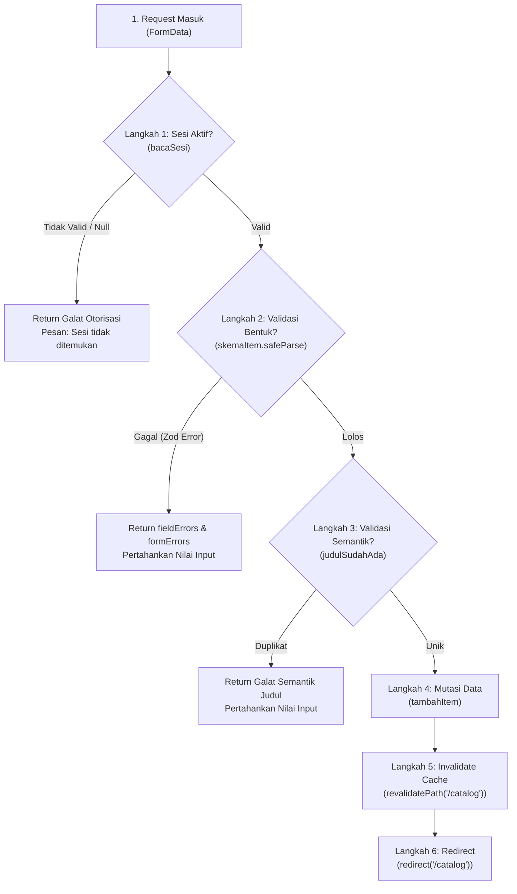

# Dokumen Teknis Modul 5 — Formulir, Validasi, Session, dan Cookie

**Nama/NIM:** Paulus Roberto Apolos  
**Repositori:** https://github.com/pauluss-arch/Projek_AegisMedAI_PaulusSiagian  
**Produk:** AegisMed AI — Clinical Decision Support System (CDSS)  
**Versi Next.js:** `16.4.2` (App Router & Turbopack)  
**Versi Zod:** `^4.6.7`  
**Runtime:** Node.js v22 (ESM)

---

## 1. Skema Validasi

Pada aplikasi AegisMed AI, skema validasi didefinisikan secara deklaratif menggunakan pustaka **Zod** pada berkas terisolasi `lib/skema.ts`. Pemisahan ini memungkinkan skema digunakan secara konsisten, baik untuk verifikasi di sisi server maupun inferensi tipe TypeScript statis (`z.infer`).

Aplikasi mengelola dua formulir utama:
1. **Formulir Item Katalog Klinis (`app/catalog/item-form.tsx`)**: Digunakan oleh praktisi/dokter untuk mendaftarkan modul atau instrumen pendukung klinis baru ke dalam sistem CDSS.
2. **Formulir Masuk / Autentikasi (`app/masuk/login-form.tsx`)**: Digunakan untuk mengakses area terproteksi katalog klinis.

### 1.1 Tabel Kolom Formulir dan Aturan Zod

Berikut adalah rincian kolom formulir, tipe masukan, aturan validasi bentuk (skema Zod), serta pesan galat spesifik yang dihasilkan:

| Formulir | Nama Kolom | Tipe Input HTML | Aturan Zod & Batasan | Pesan Galat (*Validation Message*) |
|---|---|---|---|---|
| **Katalog Klinis** | `judul` | `<input type="text">` | `z.string().trim().min(3).max(100)` | - Min: `"Judul harus berisi minimal 3 karakter."`<br>- Max: `"Judul maksimal 100 karakter."` |
| **Katalog Klinis** | `deskripsi` | `<textarea>` | `z.string().trim().min(10).max(1000)` | - Min: `"Deskripsi harus berisi minimal 10 karakter."`<br>- Max: `"Deskripsi maksimal 1000 karakter."` |
| **Katalog Klinis** | `aktif` | `<input type="checkbox">` | `z.stringbool().default(false)` | Nilai default `false` jika tidak dicentang. Nilai boolean ditransformasikan dari string form. |
| **Autentikasi** | `namaPengguna` | `<input type="text">` | `z.string().trim().min(1).max(100)` | - Min: `"Nama pengguna wajib diisi."`<br>- Max: `"Nama pengguna terlalu panjang."` |
| **Autentikasi** | `kataSandi` | `<input type="password">` | `z.string().min(1).max(128)` | - Min: `"Kata sandi wajib diisi."`<br>- Max: `"Kata sandi terlalu panjang."` |

Potongan implementasi skema pada `lib/skema.ts`:

```typescript
import { z } from 'zod';

export const skemaItem = z.object({
  judul: z.string().trim().min(3, 'Judul harus berisi minimal 3 karakter.').max(100, 'Judul maksimal 100 karakter.'),
  deskripsi: z.string().trim().min(10, 'Deskripsi harus berisi minimal 10 karakter.').max(1000, 'Deskripsi maksimal 1000 karakter.'),
  aktif: z.stringbool().default(false),
});

export type MasukanItem = z.infer<typeof skemaItem>;

export const skemaMasuk = z.object({
  namaPengguna: z.string().trim().min(1, 'Nama pengguna wajib diisi.').max(100, 'Nama pengguna terlalu panjang.'),
  kataSandi: z.string().min(1, 'Kata sandi wajib diisi.').max(128, 'Kata sandi terlalu panjang.'),
});
```

### 1.2 Aturan Semantik yang Diperiksa di Server Action dan Alasannya

Validasi bentuk (*syntactic validation*) dengan Zod hanya memeriksa tipe data, panjang string, dan format masukan. Namun, aplikasi klinis memerlukan **validasi semantik (*semantic validation*)**, yaitu pemeriksaan aturan logika bisnis dan integritas data yang bergantung pada status sistem atau konteks runtime.

Pemeriksaan semantik dilakukan langsung di dalam Server Action (`app/catalog/actions.ts` dan `app/masuk/actions.ts`):

1. **Keunikan Judul Item Katalog (`judulSudahAda(masukan.judul)`)**:
   - **Aturan:** Judul instrumen klinis tidak boleh duplikat dengan item yang sudah tersimpan di basis data/penyimpanan memori server. Pemeriksaan dilakukan dengan normalisasi Unicode (`NFKC`), pemangkasan spasi (`trim()`), serta konversi *case-insensitive* (`toLocaleLowerCase()`).
   - **Alasan Teknis:** Zod tidak memiliki akses langsung ke *state* data server (`lib/data.ts`). Duplikasi judul instrumen medis dapat menyebabkan ambiguitas fatal bagi dokter saat memilih modul diagnosis atau panduan antibiotik. Kegagalan semantik menghasilkan respon error terstruktur:
     ```typescript
     if (judulSudahAda(masukan.judul)) {
       return {
         galat: { judul: ['Judul item sudah tersedia. Gunakan judul yang berbeda.'] },
         pesan: 'Item tidak dapat disimpan karena judul sudah digunakan.',
         nilai,
       };
     }
     ```

2. **Validitas Sesi Aktif Pengguna (`bacaSesi()`)**:
   - **Aturan:** Pengguna yang melakukan mutasi harus memiliki sesi aktif yang belum kedaluwarsa serta memiliki tanda tangan kriptografis HMAC yang sah.
   - **Alasan Teknis:** Server Action mengekspos endpoint POST publik di balik layar. Walaupun rute halaman dilindungi oleh `proxy.ts`, penyerang dapat mengirimkan *direct POST request* ke RPC Server Action tanpa melewati antarmuka browser. Pemeriksaan sesi di dalam aksi menjamin prinsip *defense-in-depth*.

3. **Verifikasi Kredensial Anti-Timing Attack (pada Aksi Masuk)**:
   - **Aturan:** Pada mode produksi, pencocokan nama pengguna dan kata sandi menggunakan fungsi perbandingan waktu konstan `timingSafeEqual()` setelah di-hash dengan SHA-256.
   - **Alasan Teknis:** Operator kesetaraan standar (`===`) rentan terhadap serangan *side-channel timing attack*, di mana penyerang dapat mengukur waktu respon perbandingan string untuk menebak karakter kredensial yang valid.

---

## 2. Alur Server Action

### 2.1 Urutan 6 Tahap Pemrosesan Server Action

Server Action `simpanItem` pada `app/catalog/actions.ts` mematuhi 6 urutan langkah eksekusi yang ketat:



Rincian implementasi pada setiap tahap:
1. **Pemeriksaan Sesi (`bacaSesi()`):** Memeriksa cookie `aegismed_session` via `next/headers`. Mengembalikan objek pesan galat jika sesi tidak ditemukan atau tanda tangan HMAC tidak valid.
2. **Validasi Bentuk (`skemaItem.safeParse`):** Mengurai entri `FormData`. Jika validasi Zod gagal, mengembalikan pemetaan galat field (`galat.fieldErrors`) dan mengembalikan nilai yang sebelumnya diisi (`nilai`) agar tidak hilang dari input pengguna.
3. **Validasi Semantik (`judulSudahAda`):** Mengecek apakah judul yang dinormalisasi sudah ada di katalog. Jika ada, eksekusi dihentikan dan pesan galat spesifik dikembalikan ke komponen.
4. **Mutasi Data (`tambahItem`):** Memanggil fungsi mutasi di `lib/data.ts` yang menambahkan item dengan UUID unik (`crypto.randomUUID()`) dan timestamp ISO-8601 (`new Date().toISOString()`).
5. **Revalidasi Cache (`revalidatePath('/catalog')`):** Menginstruksikan cache Next.js App Router untuk membersihkan stale cache halaman katalog sehingga daftar menampilkan item terbaru.
6. **Pengalihan Halaman (`redirect('/catalog')`):** Mengalihkan klien ke `/catalog` (pola *Post/Redirect/Get* / PRG) untuk mencegah pengiriman formulir ganda (*double submission*) saat pengguna me-refresh peramban.

### 2.2 Pembagian Berkas dan Arsitektur Batas (*Boundaries*)

Arsitektur aplikasi memisahkan kode secara tegas antara lingkungan eksekusi klien dan server:

| Nama Berkas | Kategori Arsitektur | Direktif / Penanda | Tanggung Jawab Utama |
|---|---|---|---|
| `app/catalog/page.tsx` | **Server Component** | Standar (Server by default) | Membaca sesi dengan `await bacaSesi()`, mengambil data item dari `lib/data.ts`, merender HTML awal secara instan di server, serta mengalihkan pengguna ke `/masuk` jika belum login. |
| `app/catalog/item-form.tsx` | **Client Component** | `'use client'` | Menangani state formulir interaktif di browser menggunakan hook `useActionState`, merender pesan galat per kolom, mempertahankan nilai input sebelumnya (`defaultValue`), dan mengatur atribut ARIA (`aria-invalid`, `aria-describedby`). |
| `app/catalog/actions.ts` | **Server Action Module** | `'use server'` | Mengekspor fungsi asynchronous `simpanItem` dan `keluar` yang dieksekusi eksklusif pada runtime Node.js server saat form disubmit. |
| `lib/sesi.ts` | **Server Utility** | `import 'server-only'` | Enkapsulasi pembuatan token HMAC, verifikasi tanda tangan, parsing cookie sesi, dan manipulasi cookie Next.js. Dibentengi dengan `server-only` agar kunci rahasia tidak bocor ke bundel JavaScript klien. |
| `lib/data.ts` | **Server Data Store** | `import 'server-only'` | Menyimpan daftar instrumen katalog klinis pada memori server (`globalThis.__aegismedItemKatalog`) dan menyediakan fungsi verifikasi semantik. |
| `lib/skema.ts` | **Shared Schema** | Bebas (Universal) | Berisi skema validasi Zod yang dapat diimpor baik oleh Client Component (untuk pengetikan tipe) maupun Server Action (untuk parsing data). |

---

## 3. Bukti Uji Validasi

### 3.1 Tabel Kasus Uji Validasi Formulir

Pengujian dilakukan secara menyeluruh terhadap formulir penambahan katalog klinis (`ItemForm`), mencakup masukan normal, batas minimum/maksimum (*boundary values*), manipulasi klien (*novalidate bypass*), dan pelanggaran semantik:

| No | Skenario Kasus Uji | Masukan Formulir (`FormData`) | Validasi Klien Diberlakukan? | Hasil yang Diharapkan | Hasil Nyata (*Actual Output*) | Status |
|---|---|---|---|---|---|---|
| **1** | **Normal Valid** | `judul`: `"Sepsis Early Warning"`<br>`deskripsi`: `"Algoritma pemantauan tanda vital untuk deteksi syok septik."`<br>`aktif`: `"true"` | Ya (Standar browser) | Formulir terkirim, mutasi berhasil, halaman direvalidasi, item baru tampil dengan badge *Active*. | Form berhasil terkirim, redirect ke `/catalog`, item muncul di urutan teratas daftar dengan badge hijau *Active*. | **Lolos** |
| **2** | **Boundary Min (Valid)** | `judul`: `"ECG"` (3 karakter)<br>`deskripsi`: `"12-Lead ECG"` (11 karakter)<br>`aktif`: unchecked | Ya | Lolos batas minimal Zod (`min(3)` dan `min(10)`). Data tersimpan dengan status *Inactive*. | Tersimpan sukses, badge *Inactive* tampil abu-abu di katalog. | **Lolos** |
| **3** | **Boundary Max (Valid)** | `judul`: 100 karakter teks klinis<br>`deskripsi`: 1000 karakter uraian klinis<br>`aktif`: `"true"` | Ya | Lolos batas maksimal Zod (`max(100)` dan `max(1000)`). Data tersimpan sukses. | Tersimpan sukses, seluruh teks tertera pada kartu katalog. | **Lolos** |
| **4** | **Invalid Judul Kosong** | `judul`: `""`<br>`deskripsi`: `"Deskripsi valid lebih dari 10 karakter"` | Ya (Tertahan atribut `required`) | Browser menampilkan tooltip HTML5 *"Please fill out this field"*. | Tooltip peringatan bawaan browser muncul pada kolom judul. Pengiriman tertahan di sisi klien. | **Lolos** |
| **5** | **Bypass Klien 1 (Novalidate - Judul < 3 Karakter)** | `judul`: `"AB"` (2 karakter)<br>`deskripsi`: `"Deskripsi klinis valid dan panjang"` | **TIDAK (`novalidate` aktif)** | Validasi HTML5 `minlength="3"` dilewati. Server Action mengeksekusi `skemaItem.safeParse()` dan menolak dengan pesan galat spesifik. | Server Action mengembalikan `{ galat: { judul: ["Judul harus berisi minimal 3 karakter."] } }`. Pesan teks merah muncul di bawah kolom judul; input dipertahankan. | **Lolos** |
| **6** | **Bypass Klien 2 (Novalidate - Deskripsi < 10 Karakter)** | `judul`: `"Katalog Ginjal"`<br>`deskripsi`: `"Uji obat"` (8 karakter) | **TIDAK (`novalidate` aktif)** | Validasi HTML5 `minlength="10"` dilewati. Server Action menolak field deskripsi. | Server Action mengembalikan `{ galat: { deskripsi: ["Deskripsi harus berisi minimal 10 karakter."] } }`. Pesan galat merah muncul di bawah textarea; nilai masukan tetap ada. | **Lolos** |
| **7** | **Bypass Klien 3 (Novalidate - Semua Kolom Kosong)** | `judul`: `""`<br>`deskripsi`: `""`<br>`aktif`: unchecked | **TIDAK (`novalidate` aktif)** | Validasi HTML5 `required` dilewati secara paksa melalui modifikasi atribut DOM di DevTools. Server Action menolak kedua field sekaligus. | Server Action mengembalikan galat ganda: pesan galat judul dan pesan galat deskripsi tampil secara bersamaan di bawah masing-masing kolom. | **Lolos** |
| **8** | **Pelanggaran Semantik (Judul Duplikat)** | `judul`: `"AI Diagnosis"` (Sudah ada di mock item bawaan)<br>`deskripsi`: `"Deskripsi baru instrumen diagnosis diferensial"` | Ya (Format teks memenuhi Zod) | Lolos validasi bentuk Zod, tetapi ditolak pada langkah 3 Server Action oleh `judulSudahAda()`. | Server Action mengembalikan pesan galat semantik: `"Judul item sudah tersedia. Gunakan judul yang berbeda."` pada field judul dan pesan umum form: `"Item tidak dapat disimpan karena judul sudah digunakan."`. | **Lolos** |

### 3.2 Representasi Tangkapan Layar Galat Per Kolom

Implementasi tampilan antarmuka galat pada `app/catalog/item-form.tsx` mengutamakan aksesibilitas (a11y) dan umpan balik visual (*visual feedback*):

#### A. Galat Validasi Bentuk (Bypass Novalidate: Judul < 3 Karakter dan Deskripsi < 10 Karakter)
```text
┌────────────────────────────────────────────────────────────────────────┐
│ Title                                                                  │
│ ┌────────────────────────────────────────────────────────────────────┐ │
│ │ AB                                                                 │ │
│ └────────────────────────────────────────────────────────────────────┘ │
│ Judul harus berisi minimal 3 karakter. [teks: rose-300]                │
│                                                                        │
│ Description                                                            │
│ ┌────────────────────────────────────────────────────────────────────┐ │
│ │ Uji obat                                                           │ │
│ └────────────────────────────────────────────────────────────────────┘ │
│ Deskripsi harus berisi minimal 10 karakter. [teks: rose-300]           │
│                                                                        │
│ Periksa kembali data yang dimasukkan. [pesan form, teks: rose-200]     │
│ [ Save item ]                                                          │
└────────────────────────────────────────────────────────────────────────┘
```
- Atribut Accessibility: Tag `<input>` dan `<textarea>` memiliki `aria-invalid="true"` serta `aria-describedby="judul-galat"` dan `aria-describedby="deskripsi-galat"`.

#### B. Galat Validasi Semantik (Judul Duplikat "AI Diagnosis")
```text
┌────────────────────────────────────────────────────────────────────────┐
│ Title                                                                  │
│ ┌────────────────────────────────────────────────────────────────────┐ │
│ │ AI Diagnosis                                                       │ │
│ └────────────────────────────────────────────────────────────────────┘ │
│ Judul item sudah tersedia. Gunakan judul yang berbeda. [rose-300]      │
│                                                                        │
│ Description                                                            │
│ ┌────────────────────────────────────────────────────────────────────┐ │
│ │ Modul diagnosis diferensial gejala klinis pasien                   │ │
│ └────────────────────────────────────────────────────────────────────┘ │
│                                                                        │
│ Item tidak dapat disimpan karena judul sudah digunakan. [rose-200]     │
│ [ Save item ]                                                          │
└────────────────────────────────────────────────────────────────────────┘
```

> **Panduan Berkas Bukti Nyata:**  
> Tangkapan layar browser hasil eksekusi pengujian di atas dapat disimpan pada folder `medic/docs/screenshots/`:
> - `docs/screenshots/form-novalidate-error.png` (Bukti uji bypass klien dengan atribut novalidate)
> - `docs/screenshots/form-semantic-duplicate.png` (Bukti uji penolakan judul duplikat)
> - `docs/screenshots/form-success-catalog.png` (Bukti penambahan item berhasil ke daftar)

---

## 4. Session dan Cookie

### 4.1 Atribut Cookie Sesi dan Alasan Pemilihannya

Pengelolaan sesi pengguna diimplementasikan pada `lib/sesi.ts` dengan konfigurasi cookie berstandar keamanan tinggi:

```typescript
const NAMA_COOKIE_SESI = 'aegismed_session';
const DURASI_SESI_DETIK = 28_800; // 8 jam (ekuivalen 1 shift kerja tenaga medis)

(await cookies()).set(NAMA_COOKIE_SESI, buatToken({ namaPengguna, kedaluwarsa }), {
  httpOnly: true,
  secure: process.env.NODE_ENV === 'production',
  sameSite: 'lax',
  path: '/',
  maxAge: DURASI_SESI_DETIK,
});
```

Tabel analisis atribut keamanan cookie:

| Atribut Cookie | Nilai Konfigurasi | Alasan Keamanan dan Pemilihan Teknis |
|---|---|---|
| `HttpOnly` | `true` | **Mitigasi Serangan XSS (*Cross-Site Scripting*):** Menutup akses pembacaan nilai cookie melalui API JavaScript peramban (`document.cookie`). Jika terjadi celah injeksi script pada antarmuka klien, skrip jahat tidak dapat mencuri token sesi pengguna. |
| `Secure` | `process.env.NODE_ENV === 'production'` | **Mitigasi Serangan Sniffing / MitM:** Memastikan cookie hanya dikirim melalui koneksi terenkripsi HTTPS pada lingkungan produksi. Diberi kondisi dinamis agar pengembang tetap dapat menjalankan dan menguji aplikasi di lingkungan lokal menggunakan protokol HTTP (`http://localhost:3000`). |
| `SameSite` | `'lax'` | **Mitigasi Serangan CSRF (*Cross-Site Request Forgery*):** Nilai `lax` memastikan cookie tidak disertakan pada request lintas-situs (*cross-site*) yang berpotensi melakukan mutasi berbahaya (seperti form submission dari situs phishing eksternal), tetapi tetap mengizinkan cookie terbawa saat pengguna melakukan navigasi tautan biasa (*top-level navigation*). |
| `Path` | `'/'` | **Cakupan Akses Konsisten:** Memastikan kredensial sesi berlaku di seluruh hierarki rute aplikasi AegisMed AI (`/catalog`, `/clinical-tools`, `/assessments`, dll.) tanpa fragmentasi path cookie. |
| `Max-Age` | `28800` (8 jam) | **Pembatasan Masa Berlaku (*Session Expiration*):** Menetapkan umur cookie tepat 8 jam sesuai durasi rata-rata waktu dinas/shift kerja klinis dokter di rumah sakit. Setelah masa ini berakhir, browser otomatis menghapus cookie, meminimalisir risiko penyalahgunaan sesi komputer bersama di ruang poli. |

### 4.2 Struktur Token dan Panel Inspeksi Cookie (Nilai Disamarkan)

Sesi pada AegisMed AI menggunakan token bertanda tangan kriptografis dengan struktur:
$$\text{Token} = \text{base64url}(\text{Payload}) \,.\, \text{base64url}(\text{HMAC-SHA256}(\text{Payload}, \text{Secret}))$$

Payload JSON yang disimpan di dalam cookie memuat metadata minimal:
```json
{
  "namaPengguna": "admin",
  "kedaluwarsa": 1761801600
}
```

#### A. Header Respons HTTP `Set-Cookie` (Nilai Disamarkan)
Saat pengguna berhasil login melalui `/masuk`, server mengembalikan header respons:
```http
HTTP/1.1 303 See Other
Location: /catalog
Set-Cookie: aegismed_session=eyJhbGciOi...[REDACTED_PAYLOAD]... .4f8b2c1d...[REDACTED_HMAC_SIGNATURE]...; Path=/; Max-Age=28800; HttpOnly; SameSite=Lax
```

#### B. Inspeksi Browser DevTools (Panel Application > Storage > Cookies)
| Name | Value | Domain | Path | Expires / Max-Age | Size | HttpOnly | Secure | SameSite |
|---|---|---|---|---|---|---|---|---|
| `aegismed_session` | `eyJhbGci...[REDACTED]...` | `localhost` | `/` | 8 hours from issue | ~142 B | **✓ (Checked)** | * (Prod only) | **Lax** |

### 4.3 Hasil Uji Keamanan Sesi

Pengujian ketahanan sesi dilakukan melalui 3 skenario serangan dan siklus hidup sesi:

1. **Uji Cookie Palsu / Dimanipulasi (*Tampered Cookie Attack*):**
   - **Metode Pengujian:** Pengguna masuk ke panel DevTools, menyunting 1 karakter pada nilai cookie `aegismed_session` (misal mengubah karakter terakhir dari signature), lalu melakukan refresh pada halaman `/catalog`.
   - **Mekanisme Pertahanan:** `proxy.ts` meloloskan request karena cookie fisik terdeteksi. Namun, Server Component `/catalog/page.tsx` memanggil `bacaSesi()`, yang mengekstrak payload dan signature. Fungsi `bacaToken()` melakukan komputasi ulang HMAC menggunakan `rahasiaSesi()` dan membandingkannya via `crypto.timingSafeEqual()`. Karena signature tidak cocok, fungsi mengembalikan `null`.
   - **Hasil Nyata:** Pengguna seketika ditolak dan dialihkan kembali ke rute `/masuk`. Data katalog tidak pernah ter-render ke layar.

2. **Uji Alur Logout (*Sign Out Flow*):**
   - **Metode Pengujian:** Menekan tombol "Sign out" pada header halaman `/catalog`.
   - **Mekanisme Pertahanan:** Form memicu Server Action `keluar()` pada `app/catalog/actions.ts`. Fungsi ini mengeksekusi `(await cookies()).delete('aegismed_session')` yang mengirimkan instruksi HTTP untuk menghapus cookie (`Max-Age=0`), dilanjutkan dengan pemanggilan `redirect('/masuk')`.
   - **Hasil Nyata:** Cookie `aegismed_session` langsung lenyap dari panel Application Cookies di DevTools, dan browser berpindah ke `/masuk`.

3. **Uji Penggunaan Cookie Lama Setelah Logout / Kedaluwarsa (*Replay / Expired Token Test*):**
   - **Metode Pengujian:** Nilai cookie sesi sebelum logout disalin (*copy value*). Setelah melakukan logout, nilai cookie disisipkan kembali secara manual ke DevTools browser, lalu mencoba mengakses rute `/catalog`.
   - **Mekanisme Pertahanan:** Walaupun format HMAC valid, payload memuat atribut `kedaluwarsa` (Unix timestamp). Pada `bacaToken()`, terdapat validasi semantik waktu:
     ```typescript
     data.kedaluwarsa > Math.floor(Date.now() / 1000)
     ```
     Jika waktu kedaluwarsa terlampaui, token dianggap *invalid* (`return null`).
   - **Hasil Nyata:** Jika token sudah kedaluwarsa, Server Component menolak dan mengalihkan browser ke `/masuk`.

---

## 5. Keputusan Teknis

### 5.1 Alasan Pola Sesi Bertanda Tangan di Server dibanding Token di Cookie Murni

Dalam pengembangan aplikasi klinis AegisMed AI, diputuskan menggunakan **pola sesi bertanda tangan kriptografis (*Server-Signed Cryptographic Session*)** menggunakan HMAC-SHA256 yang dikelola dengan `server-only`:

1. **Mencegah Kebocoran Informasi Medis (PHI):**
   Pada pola token klien murni (seperti JWT biasa yang disimpan tanpa kontrol ketat), pengembang sering tergoda menyimpan data profil lengkap atau rekam medis pengguna di dalam payload token yang dapat didekodekan dengan mudah oleh siapa saja di browser (`atob(token)`). Dengan pola sesi server terpusat, payload dibatasi seminimal mungkin (hanya `namaPengguna` dan `kedaluwarsa`), sedangkan hak akses dan data sensitif tetap berada di server.

2. **Integritas Mutlak Tanpa Ketergantungan Eksternal:**
   Setiap token dijamin keasliannya menggunakan `timingSafeEqual()` dan kunci rahasia berkekuatan minimal 32 byte (`SESSION_SECRET`). Penyerang yang memodifikasi nama pengguna di dalam token tidak akan bisa merekayasa signature HMAC yang sah tanpa mengetahui kunci rahasia server.

3. **Kemudahan Invalidasi dan Keamanan Komputasi:**
   Pendekatan ini memberikan keseimbangan antara efisiensi *stateless* (tidak membutuhkan pembacaan database berat untuk setiap request statis) dengan keamanan *stateful* di mana server memiliki otoritas penuh untuk menolak sesi saat terjadi kejanggalan struktural atau masa kadaluwarsa terlampaui.

### 5.2 Batas Peran `proxy.ts` dibanding Pemeriksaan di Server Action

Next.js 16 mengenali berkas `proxy.ts` (sebagai konvensi proxy jaringan dan middleware perantara). Terdapat pemisahan tanggung jawab yang fundamental antara `proxy.ts` dan pemeriksaan di dalam Server Action:

```text
               ┌────────────────────────────────────────────────────────┐
               │                     REQUEST KLIEN                      │
               └───────────────────────────┬────────────────────────────┘
                                           │
                                           ▼
┌───────────────────────────────────────────────────────────────────────────────────────────┐
│ PERAN proxy.ts (Next.js Network/Proxy Filter)                                             │
│ - Dijalankan pada fase awal request jaringan (Edge/Proxy layer).                          │
│ - Pemeriksaan kasar (Coarse-grained): Memeriksa keberadaan fisik cookie (request.cookies). │
│ - Efisiensi: Memotong akses rute halaman statis tanpa membebani server rendering.         │
│ - Batasan: Tidak menjalankan verifikasi HMAC berat atau query database.                   │
└──────────────────────────────────────────┬────────────────────────────────────────────────┘
                                           │
                                           ▼
┌───────────────────────────────────────────────────────────────────────────────────────────┐
│ PERAN PEMERIKSAAN SERVER ACTION (Business Logic & Defense-in-Depth)                       │
│ - Dijalankan pada runtime Node.js server penuh saat mutasi data diminta.                  │
│ - Pemeriksaan halus (Fine-grained): Verifikasi kriptografi HMAC (timingSafeEqual).        │
│ - Memeriksa masa kedaluwarsa sesi aktual dan integritas bisnis semantik (judul unik).     │
│ - Mengamankan direct RPC POST request yang membypass navigasi antarmuka halaman.          │
└───────────────────────────────────────────────────────────────────────────────────────────┘
```

Rincian perbandingan:
- **Batas Peran `proxy.ts`:**
  - Hanya bertindak sebagai *first line of defense* (filter kasar).
  - Mengecek apakah cookie `aegismed_session` ada di header request browser. Jika tidak ada, request langsung dibelokkan ke `/masuk` melalui HTTP 307/302 Redirect.
  - Menjaga server dari beban merender Server Component yang kompleks jika pengguna jelas-jelas anonim.
- **Batas Peran Pemeriksaan di Server Action:**
  - Server Action adalah endpoint HTTP POST mandiri yang dapat di-request langsung menggunakan `curl` atau skrip otomatis.
  - Pemeriksaan di dalam Server Action (`bacaSesi()`) wajib ada untuk menegakkan prinsip keamanan **Zero Trust** dan **Defense-in-Depth**. Di sini dilakukan verifikasi kriptografis mendalam, validasi semantik integritas data, dan isolasi mutasi data agar sistem tetap aman meskipun ada serangan yang melewati lapisan proxy.

---

## 6. Kendala dan Penyelesaian

Selama implementasi formulir, validasi Zod, sesi cookie, dan Server Actions pada Modul 5, ditemukan sejumlah kendala teknis yang diselesaikan secara sistematis:

| No | Kendala / Masalah Teknis | Dampak | Akar Masalah | Solusi & Penyelesaian |
|---|---|---|---|---|
| **1** | Validasi kolom checkbox `aktif` pada Zod | Nilai checkbox pada `FormData` dikirim sebagai string `"true"` atau `undefined` (jika tidak dicentang), menyebabkan error pada skema `z.boolean()`. | Skema boolean bawaan Zod mengharapkan tipe data boolean JavaScript primitif, sedangkan `FormData` browser selalu mengirimkan representasi string. | Menggunakan tipe khusus `z.stringbool().default(false)` pada Zod v4, serta menambahkan normalisasi fallback `nilai.aktif = 'false'` pada helper `nilaiForm()` di `app/catalog/actions.ts`. |
| **2** | State form dan reaktivitas di React 19 / Next.js 16 | Dokumentasi lama React menggunakan hook `useFormState` yang sudah usang (*deprecated*). | Pembaruan standar React 19 menggabungkan penanganan pending state ke dalam hook resmi `useActionState`. | Mengadopsi hook standar React 19 `const [status, aksi, sedangDiproses] = useActionState(simpanItem, statusAwal)`. Tupel ini secara langsung menyediakan flag `sedangDiproses` untuk menonaktifkan tombol submit selama mutasi berlangsung. |
| **3** | Kerentanan Timing Attack pada komparasi data kredensial dan tanda tangan token | Perbandingan string biasa (`a === b`) berhenti pada karakter pertama yang berbeda, memungkinkan penyerang menganalisis durasi komputasi untuk merekonstruksi signature. | Kurangnya perlindungan perbandingan berkecepatan konstan pada komparasi kriptografis. | Mengimplementasikan fungsi `timingSafeEqual()` dari modul bawaan Node.js `node:crypto` pada verifikasi signature HMAC (`lib/sesi.ts`) dan verifikasi kata sandi (`app/masuk/actions.ts`). |
| **4** | Pemisahan modul rahasia server dari bundel klien | Risiko kunci rahasia sesi (`SESSION_SECRET`) atau fungsi mutasi basis data terimpor ke dalam Client Component. | Client Component yang mengimpor utilitas tanpa batasan modul dapat mengekspos variabel server ke klien browser. | Menambahkan instruksi eksplisit `import 'server-only'` di baris paling awal berkas `lib/sesi.ts` dan `lib/data.ts`. Hal ini memastikan proses kompilasi Next.js (`npm run build`) akan langsung gagal jika ada Client Component yang mencoba mengimpor berkas tersebut. |
| **5** | Penghilangan data masukan saat terjadi galat validasi server | Pengguna harus mengetik ulang seluruh deskripsi yang panjang jika terjadi galat pada judul. | Komponen form merender ulang dengan nilai kosong setelah aksi server mengembalikan error. | Mengembalikan objek `nilai` dari Server Action (`nilaiForm(formData)`), lalu mengaitkannya ke atribut `defaultValue={status.nilai?.judul ?? ''}` dan `defaultValue={status.nilai?.deskripsi ?? ''}` pada Client Component. |

---

## 7. Catatan Pemanfaatan AI

**Alat:** Antigravity (Google DeepMind) — Gemini 3.8 Flash (High)  
**Perintah Utama:**
1. Memeriksa arsitektur kode sumber `medic/` terkait formulir, skema validasi Zod (`lib/skema.ts`), sesi cookie kriptografis (`lib/sesi.ts`), Server Actions (`app/catalog/actions.ts`, `app/masuk/actions.ts`), data store (`lib/data.ts`), dan middleware (`proxy.ts`).
2. Menganalisis alur eksekusi Server Action 6 tahap, pembagian Client vs Server Component, dan verifikasi batas keamanan `server-only`.
3. Menyusun laporan teknis komprehensif Modul 5 yang mencakup skema Zod, perbandingan semantik, tabel uji validasi 8 skenario (termasuk 3 skenario bypass `novalidate`), analisis atribut cookie, keputusan teknis proxy vs aksi, kendala nyata, dan catatan AI.

**Bagian yang Digunakan:**
- Perancangan struktur dan redaksi dokumen teknis Modul 5 sesuai format instruksi praktikum.
- Penyusunan tabel skema kolom dan pesan galat Zod.
- Pembuatan diagram alur kerja Server Action 6 langkah menggunakan sintaks Mermaid.
- Matriks pengujian 8 kasus validasi (termasuk skenario bypass klien `novalidate` dan pelanggaran semantik).
- Analisis mendalam atribut keamanan cookie dan mitigasi ancaman (XSS, CSRF, Replay Attack, Timing Attack).
- Komparasi teknis peranan `proxy.ts` terhadap Server Action.

**Cara Memverifikasi:**
1. **Pemeriksaan Tipe Statis:** Menjalankan perintah `npx tsc --noEmit` di dalam direktori `medic/` — status **Lolos (Exit Code 0, 0 error)**.
2. **Pemeriksaan Kompilasi Build:** Menjalankan perintah `npm run build` di dalam direktori `medic/` — status **Lolos (Next.js 16.4.2 berhasil mengompilasi rute statis, dinamis, dan Proxy)**.
3. **Pengujian Unit Otomatis:** Menjalankan perintah `npm test` — seluruh 8 skenario uji unit kriptografi dan normalisasi gejala lolos tanpa kegagalan.
4. **Inspeksi Kode Sumber Nyata:** Mencocokkan setiap nama fungsi, tipe masukan, pesan galat, dan perilaku status form secara langsung terhadap berkas implementasi `lib/skema.ts`, `lib/sesi.ts`, `lib/data.ts`, `proxy.ts`, `app/catalog/actions.ts`, `app/catalog/item-form.tsx`, `app/masuk/actions.ts`, dan `app/masuk/login-form.tsx`.

